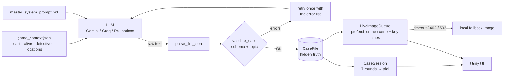

# Architecture

How the mystery pipeline is put together, why each decision was made, and what is still
broken. Read this before changing the prompt, the case-file schema or `Core/`.

## 1. The flow of one case

A case is generated **once**, up front, and then frozen. Everything the player does
afterwards (dialogue, clue reveals, the trial) is checked against that frozen truth. This is
what keeps the mystery consistent: the LLM cannot change who the killer is halfway through,
because the game only ever accepts clue ids that already exist in the case file.

## 2. Key decisions and why

### 2.1 A JSON contract between Narrative and Unity
`narrative/sample_case.json` is a hand-written, valid case file. It is the single source of
truth for the shape of the data. The prompt's `# Output` section, `validate_case.py` and
`Core/CaseFile.cs` all mirror it.

- **Why:** two teams (Narrative and Unity) can work in parallel against a fixed example
  instead of waiting for the LLM to produce something usable.
- **Cost:** the schema lives in three places. If you add a field, change all three plus the
  sample, and run the validator and the tests.

`CaseFile.cs` uses public fields + `[Serializable]` so it loads with both `JsonUtility` and
Newtonsoft. `JsonUtility` turns JSON `null` strings into `""`, so code checks
`string.IsNullOrEmpty`, never `== null`.

### 2.2 Validation in two layers
| Layer | Tool | Question | Fails on |
| --- | --- | --- | --- |
| Legality | `validate_case.py` | Can the game load and run this? | missing fields, unknown ids/locations, detective as culprit, banned image words, wrong clue counts |
| Design | `audit_case.py` | Is this a *good* mystery? | unsolvable, solvable in 1 action, evidence that does not single out the culprit, derivative host lines |

They are separate on purpose. Legality is a hard gate (a failing case is regenerated).
Design quality is a KPI we track over many runs; one mediocre case is acceptable, a trend is not.

`audit_case.py` contains a small solver: the fewest actions (visit a location / question an
NPC) needed to collect ≥ 2 key clues that point to the culprit, ignoring skill-locked clues.
It then computes the **exact** probability that 7 d6 rounds give that many actions by
enumerating all 6⁷ = 279,936 roll sequences once at import. This links the narrative output to
the dice rules with a number, instead of an opinion.

### 2.3 Engine-free rules (`Core/`)
`DiceRules`, `WordLimiter`, `TrustTracker` and `CaseSession` have no `UnityEngine` import.

- **Why:** the rules can be unit-tested with `dotnet test` in under a second, without opening
  Unity. The test project compiles the same source files (linked, not copied) at C# 9, so
  anything that passes here compiles in Unity.
- The dice are injected (`IDice`). `ScriptedDice` plays a fixed sequence, used by tests and
  as a **demo-safety switch**: in the live presentation we can avoid a run of 1s.
- `CaseSession` is a small state machine (`Incident → Investigation → Trial → Solved/GameOver`)
  that throws on illegal transitions, so UI bugs surface immediately instead of corrupting state.
- `TrustTracker.Apply` clamps the LLM's `trust_change` to −1..+1 and the score to −2..+2. The
  model is never trusted to stay in range.

### 2.4 Filter-safe image prompts
Image providers refuse violent prompts. The prompt bans a word list (blood, corpse, knife…)
and gives visual-novel substitutes ("unconscious anime character", "neon pink liquid"). The
validator enforces the list; the auditor tracks a second list of words that are not banned but
still get flagged (blade, rope, pills…).

### 2.5 Live images under a free-tier rate limit
Measured on 2026-11-23: Pollinations free tier serves **1 image per 45 s per IP** (HTTP 402
otherwise) plus server-wide 503s. `LiveImageQueue` is designed around that:

1. Prefetch as soon as the case file arrives, crime scene first (it is shown at discovery).
2. One request every `minIntervalSeconds` (46 s), each with a timeout.
3. Any failure falls back to a local generic texture; the real one is swapped in via the
   `Ready` event if it lands later.

The demo never blocks on the network.

### 2.6 Benchmarks are reproducible
`benchmark_llm.py` adds a per-run seed to the user message. Without it the free API returned
**cached, identical** cases, which made the first baseline meaningless. Raw outputs are saved
next to `summary.json`, so any KPI can be recomputed with a newer validator.

## 3. Current numbers

| KPI | Value | Evidence |
| --- | --- | --- |
| Core rule tests | 30/30 pass | `dotnet test tests/CoreTests` |
| Case JSON valid (prompt v0) | 4/5 | `baselines/baseline-v0-pollinations/` |
| Case logic pass (prompt v0) | 0/5 | same |
| Case JSON valid (prompt v1) | 3/5 | `baselines/baseline-v1-pollinations/` |
| Case logic pass (prompt v1) | 0/5 | same |
| Image success (free tier) | 2/6 (11-23), 6/11 (11-25) | `baselines/*-images/`, `baselines/_v1_images.log` |

Samples are small (5 runs) because the free tier is slow. Treat them as direction, not as
statistics.

## 4. Known limitations (honest list)

1. **Generation never passes logic checks yet (0/5 on v0 and v1).** v1's self-check removed
   missing NPC secrets (3/5 → 0/5) and false clues accusing the killer (2/5 → 0/5), but every
   run still fails something. The failures left are truncation (2/5), an invented `kitchen`,
   a banned word (`hanging`) and too few innocent liars (1/5 each). Prompt text alone
   has plateaued on this model; the next step is decoding-level constraints (JSON schema
   output on Gemini/Groq) plus the validator-driven retry that `--retry` already implements.
2. **The sample case itself trips the derivative-host check** (`"Ding-dong! A body has been
   discovered"`). The game's identity is too close to a well-known franchise; see the jury
   critique.
3. **No NPC dialogue prompt yet.** `CaseSession.CompleteAction` expects
   `{reply, trust_change, revealed_clues}` but nothing produces it. Unity must reject any
   `revealed_clues` id that is not in the case file or not in that NPC's `knows`.
4. **Character skills are placeholders** (`"TBD"` in `game_context.json`), so skill-locked
   clues are only partly testable.
5. **The trial is a single vote.** No argument phase or twist yet.

## 5. Where to make a change

| You want to… | Edit | Then run |
| --- | --- | --- |
| Change the generator | `narrative/master_system_prompt.md` | `benchmark_llm.py --retry`, `audit_case.py`, add a `PROMPT_LOG` entry |
| Add a case-file field | sample, prompt `# Output`, `validate_case.py`, `CaseFile.cs` | `validate_case.py` on the sample, `dotnet test` |
| Change dice / trust / rounds | `unity/Assets/Scripts/Core/` | `dotnet test` (update `audit_case.py` constants if dice change) |
| Change image style | `LiveImageQueue` style strings + `benchmark_images.py` `STYLE` | `benchmark_images.py` |
