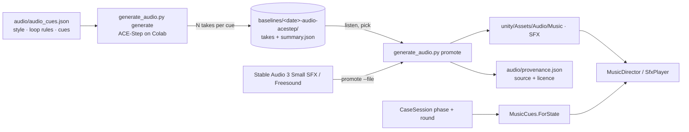

# Audio pipeline (Team 3)

Music loops and sound effects are **generated offline and shipped as static assets**, as the brief
says. Nothing calls an audio API while the game runs, so the live demo cannot fail on audio.
**Every tool here is free**: open-weight models on a free Colab GPU or a laptop CPU, no paid API.

| What | Tool | Licence | Runs on |
| --- | --- | --- | --- |
| Music loops + stingers | ACE-Step 1.5, through `tools/generate_audio.py --provider acestep` | MIT | Colab free GPU or any GPU with ~4 GB VRAM |
| Sound effects | Stable Audio 3 **Small SFX** (local UI or the official demo Space) | Stability AI Community License (free under $1M revenue) | CPU is enough |
| SFX fallback | Freesound.org (as in the brief) | per sound: prefer CC0 | browser |
| Pipeline / Unity tests | `--provider mock` | — | anything |



## 1. Music with ACE-Step 1.5 (Colab, free GPU)

Runtime → Change runtime type → GPU. Then:

```bash
!git clone https://github.com/ACE-Step/ACE-Step-1.5 && cd ACE-Step-1.5 && pip install uv && uv sync
!cd ACE-Step-1.5 && nohup uv run acestep-api > api.log 2>&1 &      # REST server on 127.0.0.1:8001
!git clone https://github.com/101PHOENIX/genai-lms-project-group4
!cd genai-lms-project-group4 && python tools/generate_audio.py generate --provider acestep --only investigation trial
```

- First start downloads the weights; wait until `api.log` says the server is up. If the first
  request cannot connect, the tool stops the run instead of failing every cue.
- The server is async (`/release_task`, then `/query_result` polling); the tool handles it.
  Instrumental is requested with `lyrics: "[Instrumental]"`; `bpm` and `key` from the manifest are
  sent as native parameters. Check the first takes have no vocals.
- Zip and download the run folder before the Colab session ends.
- Same thing on a local GPU: run `uv run acestep-api` and set `ACESTEP_URL` (env or `.env`).
- For a quick listen without installing anything, the official ACE-Step Space on Hugging Face and
  acemusic.ai are free web UIs; takes made there can be imported with `promote --file`.

Each run writes `baselines/<date>-audio-acestep/`: the takes (gitignored, too big) and
`summary.json` (committed): prompts sent, settings, licence, success rate, latency p50/max, seconds
of audio generated.

Errors: 429/5xx and network errors are retried with exponential backoff (honours `Retry-After`);
other 4xx are not retried and the server's message is kept in `summary.json`. A failed or timed-out
task (15 min) fails that take only.

## 2. Sound effects with Stable Audio 3 Small SFX

Eight one-shots do not justify adding PyTorch to the tooling, so SFX are made in the model's UI and
imported.

1. Accept the licence on the Hugging Face page of `stabilityai/stable-audio-3-small-sfx` (gated,
   free account).
2. Either use the official Stable Audio 3 demo Space, or run it locally (CPU works for Small):
   ```bash
   git clone https://github.com/Stability-AI/stable-audio-3 && cd stable-audio-3 && uv sync
   huggingface-cli login
   uv run python run_gradio.py --model small-sfx
   ```
3. Paste the `prompt` and `duration_s` of each entry in the `sfx` list of `audio/audio_cues.json`.
   Make 2-3 takes, keep the best as WAV.

No luck with a sound? Take it from Freesound (filter by CC0 licence) and record the author.

## 3. Listen and promote

A music take is acceptable when: no vocals, no intro/outro, the loop seam is not audible in the
game (check it in Unity: the director crossfades the seam), and it fits the scene.

```bash
# a take from a generate run
python tools/generate_audio.py promote investigation --run baselines/20261126-1010-audio-acestep --take 2
# an external file (Stable Audio 3 UI, Freesound, a web UI)
python tools/generate_audio.py promote dice_roll --file ~/Downloads/dice.wav \
    --source "Stable Audio 3 Small SFX" --licence "Stability AI Community License"
python tools/generate_audio.py promote door_open --file door.wav --source "Freesound: <author>, <sound id>" --licence CC0
```

The file lands in `unity/Assets/Audio/Music/` or `Audio/SFX/` (from the cue's kind) as
`<cue id>.<ext>`; Unity formats only (wav, mp3, ogg, aiff). Provider, prompt, take or source, and
licence go to `audio/provenance.json`. `--file` refuses to run without `--source` and `--licence`:
that file is the attribution record for the Moodle PDF and the credits slide.

Then add a row to `ITERATION_LOG.md` and, if the prompt changed, a `PROMPT_LOG.md` entry. Suggested
KPIs: success rate, takes needed per accepted cue, latency p50.

## 4. Unity wiring

1. Create an `Audio` GameObject in the first scene (`DontDestroyOnLoad` if scenes change) and add
   `MusicDirector` and `SfxPlayer`. Drag the director into the player's `music` field.
2. Fill the `clips` lists: cue id + clip. Ids are the constants in `MusicCues` and `SfxPlayer.Ids`.
   A missing `investigation_late` falls back to `investigation`; any other missing cue fades to silence.
3. Import settings: music clips `Load Type = Streaming`, `Compression = Vorbis`; SFX `Decompress On Load`.
4. Hook it where the game already does these things:

```csharp
music.Bind(session);                                           // right after new CaseSession(...)
sfx.Play(SfxPlayer.Ids.BodyAlarm, duckMusic: true);            // discovery sequence, while the crime scene loads
sfx.Play(SfxPlayer.Ids.DiceRoll);                              // RollForRound
session.KeyClueFound += _ => sfx.Play(SfxPlayer.Ids.ClueFound);
music.Bind(null); music.Play(MusicCues.Exploration);           // map / character selection / between cases
```

The director polls `session.Phase` and `session.Round`, so `CaseSession` needed no changes.
Rounds 6-7 switch to `investigation_late`; `Solved` plays the `victory` stinger and returns to
`exploration`; `GameOver` plays `game_over` and stays silent. Use the `verdict_*` SFX or the
`victory`/`game_over` stingers at the verdict, not both at once.

## 5. Changing a cue

Edit `audio/audio_cues.json`. If you add or rename a music cue, update `MusicCues.cs` (and
`ForState` if it maps to a state); for SFX update `SfxPlayer.Ids`. `tests/test_generate_audio.py`
fails if the ids in the JSON and in C# drift apart.

```bash
python -m unittest discover -s tests -p "test_*.py"
dotnet test tests/CoreTests
```

## 6. Licences

- ACE-Step 1.5: MIT. Stable Audio 3 Small: Stability AI Community License (free, commercial use
  allowed under $1M annual revenue). Freesound: per sound, keep the author for CC-BY.
- Never put artist, song or franchise names in prompts (it also feeds the derivative-identity
  problem noted in `docs/ARCHITECTURE.md`).
- Keep `audio/provenance.json` up to date and list the tools in the credits slide.
